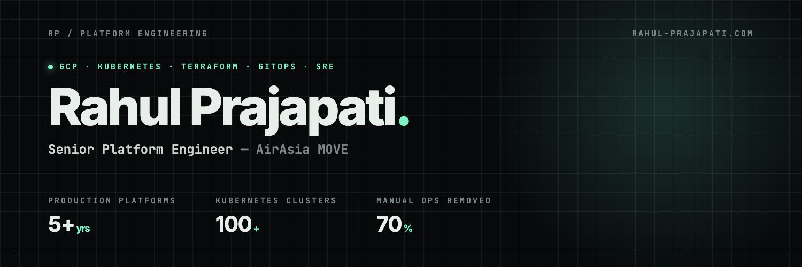

<a href="https://rahul-prajapati.com"></a>

<p align="center">
  <a href="https://rahul-prajapati.com"></a>
  <a href="https://rahul-prajapati.com/blog/"></a>
  <a href="https://linkedin.com/in/rahulkumarprajapati"></a>
  <a href="https://x.com/prajapatikrahul"></a>
  <a href="https://medium.com/@rahulkprajapati"></a>
</p>

```console
$ whoami
rahul — senior platform engineer @ AirAsia MOVE, Bangalore

$ cat what-i-do.txt
→ design, build and run cloud platforms end to end: GCP, AWS, Azure
→ Kubernetes, infrastructure as code, CI/CD, GitOps, networking, security
→ observability, reliability and incident response when it matters most
→ automate everything repeatable, from Terraform to tooling to AI agents

$ kubectl get experience --sort-by=.start
NAME             ROLE                         SINCE
airasia-move     Senior Platform Engineer     2026   ● running
alteryx          Cloud Engineer               2024   ✓ completed
zeotap           DevOps Engineer              2023   ✓ completed
airasia          Software Engineer, DevOps    2022   ✓ completed
searce           Cloud Engineer               2021   ✓ completed
```

### 📈 &nbsp;By the numbers

| **5+ yrs** | **100+** | **30+** | **70%** | **60%** |
|:---:|:---:|:---:|:---:|:---:|
| running production platforms | Kubernetes clusters managed | Terraform modules built | manual ops automated away | cloud cost cut (App Engine → Cloud Run) |

### ✍️ &nbsp;Latest from the blog

<!-- BLOG-POST-LIST:START -->
- [Give an AI agent gcloud, kubectl and Terraform without the keys](https://rahul-prajapati.com/blog/ai-agent-gcloud-kubectl-terraform-least-privilege/)
- [Debug Cloud NAT port exhaustion behind a Kong gateway on GKE](https://rahul-prajapati.com/blog/cloud-nat-port-exhaustion-kong-gke/)
- [Replace service account JSON keys with Workload Identity on GKE](https://rahul-prajapati.com/blog/gke-workload-identity-replace-service-account-keys/)
<!-- BLOG-POST-LIST:END -->

<sub>Updated automatically from the <a href="https://rahul-prajapati.com/blog/feed.xml">RSS feed</a>. New hands-on posts every Tuesday and Friday.</sub>

### 🧰 &nbsp;Daily toolkit

<p>
  
  
  
  
  
  
  
  
  
  
  
  
  
  
  
  
</p>

### 🏅 &nbsp;Certified

`Google Cloud Professional Cloud Architect` · `Google Cloud Professional DevOps Engineer` · `Google Cloud Associate Cloud Engineer` · `GitOps with Argo CD` · `Azure Fundamentals`

<details>
<summary><b>🔭 &nbsp;What I've shipped</b> (click to expand)</summary>
<br>

- **AirAsia MOVE:** core platform engineer across the whole stack: cloud infrastructure, Kubernetes, databases, security, delivery pipelines, automation and production reliability.
- **Alteryx:** automated multi-cloud infrastructure across GCP, AWS and Azure; built 30+ Terraform modules and ran 100+ Kubernetes clusters through Argo CD and GitOps; rolled out Teleport access, cutting onboarding time by 60%.
- **Zeotap:** observability with Grafana, New Relic and Managed Prometheus that cut downtime by 25%; CI/CD on CircleCI and Harness.
- **AirAsia:** multi-cluster GKE with canary traffic, the move to GKE Autopilot and Anthos Service Mesh, and an App Engine → Cloud Run migration that cut costs by 60%.
- **Searce:** modular Terraform for Google Cloud foundations and AWS → GCP migrations.

</details>

<p align="center"><sub>Find the full story at <a href="https://rahul-prajapati.com">rahul-prajapati.com</a>.</sub></p>
